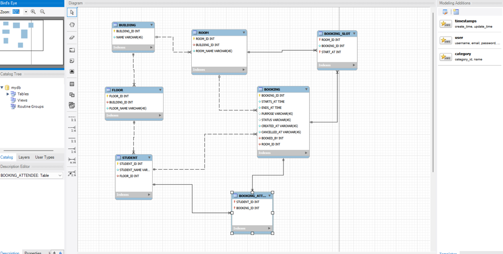

## 릴레이션 스키마

BUILDING(
    BUILDIND_ID PK,
    NAME
)

ROOM(
    ROOM_ID PK,
    BUILDING_ID,
    ROOM_NAME
)

FK: BUILDING(BUILDING_ID) → ROOM(BUILDING_ID)

BOOKING_SLOT(
    BOOKING_ID PK,
    STARTS_AT PK,
    ROOM_ID
)

FK: ROOM(ROOM_ID) → BOOKING_SLOT(ROOM_ID)

FLOOR(
    FLOOR_ID PK,
    BUILDING_ID,
    FLOOR_NAME
)

FK: BUILDING(BUILDING_ID) → FLOOR(BUILDING_ID)

STUDENT(
    STUDENT_ID PK,
    STUDENT_NAME,
    FLOOR_ID
)

FK: FLOOR(FLOOR_ID) → STUDENT(FLOOR_ID)

BOOKING(
    BOOKIND_ID PK,
    STARTS_AT,
    END_AT,
    PURPOSE,
    STATUS,
    CREATED_AT,
    CANCELLED_AT,
    BOOKED_BY,
    ROOM_ID
)

FK: STUDENT(STUDENT_ID) → BOOKING(BOOKED_BY)
    ROOM(ROOM_ID) → BOOKING(ROOM_ID)

BOOKING_ATTENDEE(
    STUDENT_ID PK,
    BOOKING_ID PK
)

PK: STUDENT(STUDENT_ID) → BOOKING_ATTENDEE(STUDENT_ID)
    BOOKING(BOOKING_ID) → BOOKING_ATTEDEE(BOOKING_ID)


## 15번
```
 한 회사는 최근 AWS로 마이그레이션했으며 프로덕션 VPC에 들어오고 나가는 트래픽을 보호하는 솔루션을 구현하려고 합니다. 이 회사는 온프레미스 데이터 센터에 검사 서버를 갖고 있었습니다. 점검서버는 트래픽 흐름 점검, 트래픽 필터링 등의 특정 작업을 수행했다. 회사는 AWS 클라우드에서도 동일한 기능을 갖기를 원합니다.
이러한 요구 사항을 충족하는 솔루션은 무엇입니까?

① A. 프로덕션 VPC에서 트래픽 검사 및 트래픽 필터링을 위해 Amazon GuardDuty를 사용하십시오.
② B. 트래픽 미러링을 사용하여 트래픽 검사 및 필터링을 위해 프로덕션 VPC의 트래픽을 미러링합니다.
③ C. AWS 네트워크 방화벽을 사용하여 프로덕션 VPC에 대한 트래픽 검사 및 트래픽 필터링에 필요한 규칙을 생성합니다.
④ D. AWS Firewall Manager를 사용하여 프로덕션 VPC에 대한 트래픽 검사 및 트래픽 필터링에 필요한 규칙을 생성합니다.
```
**정답 3번, 나는 4번 고름**

- **Amazon GuardDuty**: AWS 환경에서 의심스러운 활동을 찾아내는 **위협 탐지 서비스**임. 

    ◆ 악성 IP와의 통신이나 비정상적인 계정 활동 등을 발견하기 위해 사용
    
    ◆ 네트워크 통신 기록 등의 데이터를 분석해 **보안 탐지 결과를 생성함**.

    ◆ Network firewall은 통신 경로에서 허용 및 차단하고, **GuardDuty는 활동을 분석해 위협을 탐지함**.

- **VPC Traffic Mirroring**: 네트워크 트래픽의 **복사본**을 분석 장비로 보내는 VPC 기능
    → 보안 분석이나 통신 문제 조사에 사용됨.
    → 원본 통신은 계속 진행하고, 복사본을 별도로 분석함.

- **AWS Network Firewall** : VPC의 네트워크 트래픽을 검사하고 필터링하는 **AWS 관리형 방화벽**임.
    → 위험한 통신을 차단하고, 허용된 통신만 통과시키기 위해 사용함.
    → 규칙에 따라 트래픽을 검사하고, 연결상태를 고려하는 검사를 지원함

- **AWS Firewall Manager** : 여러 AWS 계정과 리소스에 보안 정책을 일관되게 적용하는 **중앙 관리 서비스**. 말그대로 관리자..?
    → 계정과 VPC가 많을 때 보안 규칙을 하나씩 설정하는 부담과 누락을 줄이기 위해 사용됨.
    → Aws Organizations 라는 **여러 AWS 계정을 하나의 조직으로 관리하는 서비스**와 연계됨.

## 16번

```
한 회사가 AWS에서 데이터 레이크를 호스팅하고 있습니다. 데이터 레이크는 Amazon S3 및 PostgreSQL용 Amazon RDS의 데이터로 구성됩니다. 회사에는 데이터 시각화를 제공하고 데이터 레이크 내의 모든 데이터 소스를 포함하는 보고 솔루션이 필요합니다. 회사의 관리팀만이 모든 시각화에 대한 전체 액세스 권한을 가져야 합니다. 회사의 나머지 부분은 제한된 액세스 권한만 가져야 합니다.
이러한 요구 사항을 충족하는 솔루션은 무엇입니까?

① A. Amazon QuickSight에서 분석을 생성합니다. 모든 데이터 소스를 연결하고 새 데이터세트를 생성합니다. 데이터를 시각화하기 위해 대시보드를 게시합니다. 적절한 IAM 역할과 대시보드를 공유합니다.
② B. Amazon QuickSight에서 분석을 생성합니다. 모든 데이터 소스를 연결하고 새 데이터세트를 생성합니다. 데이터를 시각화하기 위해 대시보드를 게시합니다. 적절한 사용자 및 그룹과 대시보드를 공유합니다.
③ C. Amazon S3의 데이터에 대한 AWS Glue 테이블과 크롤러를 생성합니다. AWS Glue 추출, 변환 및 로드(ETL) 작업을 생성하여 보고서를 생성합니다. 보고서를 Amazon S3에 게시합니다. S3 버킷 정책을 사용하여 보고서에 대한 액세스를 제한합니다.
④ D. Amazon S3의 데이터에 대한 AWS Glue 테이블과 크롤러를 생성합니다. Amazon Athena Federated Query를 사용하여 PostgreSQL용 Amazon RDS 내의 데이터에 액세스합니다. Amazon Athena를 사용하여 보고서를 생성합니다. 보고서를 Amazon S3에 게시합니다. S3 버킷 정책을 사용하여 보고서에 대한 액세스를 제한합니다.
```
**정답 2번, 나는 3번**

- Amazon QuickSight: 데이터를 차트와 대시보드로 보여줌
- Amazon Glue: 데이터를 수집, 정리, 변환함
- Athena: SQL로 데이터를 조회함
- S3: 데이터와 결과 파일을 저장함

▶ 시각화, 대시보드: QuickSight

▶ 데이터변환 및 ETL: Glue

▶ SQL 조회: Athena

▶ 대시보드 공유: QuickSight 사용자. 그룹

## 17번
```
회사에서 새로운 비즈니스 애플리케이션을 구현하고 있습니다. 애플리케이션은 두 개의 Amazon EC2 인스턴스에서 실행되며 문서 저장을 위해 Amazon S3 버킷을 사용합니다. 솔루션 아키텍트는 EC2 인스턴스가 S3 버킷에 액세스할 수 있는지 확인해야 합니다. 이 요구 사항을 충족하려면 솔루션 설계자가 무엇을 해야 합니까?

① A. S3 버킷에 대한 액세스 권한을 부여하는 IAM 역할(role)을 생성합니다. EC2 인스턴스에 역할을 연결합니다.
② B. S3 버킷에 대한 액세스 권한을 부여하는 IAM 정책(policy)을 생성합니다. EC2 인스턴스에 정책을 연결합니다.
③ C. S3 버킷에 대한 액세스 권한을 부여하는 IAM 그룹(group)을 생성합니다. 그룹을 EC2 인스턴스에 연결합니다.
④ D. S3 버킷에 대한 액세스 권한을 부여하는 IAM 사용자를 생성합니다. 사용자 계정을 EC2 인스턴스에 연결합니다.
```
**정답 1번, 나는 3번**

- 정책(Policy) - 무엇을 허용 및 거부하는지 적는 규칙
- 역할(Role) - 맡아서 사용할 수 있는 권한
- 사용자(User) - 고유한 자격 증명을 가질 수 있는 신원
- 그룹(Group) - 여러 IAM 사용자를 묶어 권한 관리

## 18번
```
애플리케이션 개발 팀은 큰 이미지를 더 작은 압축 이미지로 변환하는 마이크로서비스를 설계하고 있습니다. 사용자가 웹 인터페이스를 통해 이미지를 업로드하면 마이크로서비스는 Amazon S3 버킷에 이미지를 저장하고, AWS Lambda 함수를 사용하여 이미지를 처리 ​​및 압축한 다음, 다른 S3 버킷에 압축된 형식으로 이미지를 저장해야 합니다.
솔루션 아키텍트는 내구성이 뛰어난 상태 비저장 구성 요소를 사용하여 이미지를 자동으로 처리하는 솔루션을 설계해야 합니다.
이러한 요구 사항을 충족하는 작업 조합은 무엇입니까? (2개를 선택하세요.)

① A. Amazon Simple Queue Service(Amazon SQS) 대기열을 생성합니다. 이미지가 S3 버킷에 업로드될 때 SQS 대기열에 알림을 보내도록 S3 버킷을 구성합니다.
② B. Amazon Simple Queue Service(Amazon SQS) 대기열을 호출 소스로 사용하도록 Lambda 함수를 구성합니다. SQS 메시지가 성공적으로 처리되면 대기열에서 메시지를 삭제합니다.
③ C. S3 버킷의 새 업로드를 모니터링하도록 Lambda 함수를 구성합니다. 업로드된 이미지가 감지되면 메모리의 텍스트 파일에 파일 이름을 쓰고 해당 텍스트 파일을 사용하여 처리된 이미지를 추적합니다.
④ D. Amazon EC2 인스턴스를 시작하여 Amazon Simple Queue Service(Amazon SQS) 대기열을 모니터링합니다. 항목이 대기열에 추가되면 EC2 인스턴스의 텍스트 파일에 파일 이름을 기록하고 Lambda 함수를 호출합니다.
⑤ E. S3 버킷을 모니터링하도록 Amazon EventBridge(Amazon CloudWatch Events) 이벤트를 구성합니다. 이미지가 업로드되면 추가 처리를 위해 애플리케이션 소유자의 이메일 주소와 함께 Amazon ample 알림 서비스(Amazon SNS) 주제에 알림을 보냅니다.
```
**정답 1,2번 , 내가 쓴 답 1,4번**

★ 내구성이 뛰어난 : 처리에 실패해도 할 일의 기록이 남아 있어야 함.
★ 상태 비저장: 특정 서버에 적어 둔 기록에 의존하지 않고

이 문제에서 알아야 할 것 → **내구성이 뛰어난 상태 비저장 구성 요소를 사용**
- 우선 4번에서 **EC2 인스턴스의 텍스트 파일에 파일 이름을 기록** 은 비저장 구성 요소 조건에 어긋나는 것
- 5번, Lambda 함수로 압축하는 부분이 없음
- 3번, 내구성 부족(Lambda 함수가 종료되면 메모리에 기록한 파일 이름이 사라질 수 있음) /  상태 비저장 위반(메모리에 이전 실행 과정을 기록하면, 다른 실행환경에서 이를 보지 못함)

## 19번
```
회사에는 AWS에 배포된 3티어 웹 애플리케이션이 있습니다. 웹 서버는 VPC의 퍼블릭 서브넷에 배포됩니다. 애플리케이션 서버와 데이터베이스 서버는 동일한 VPC의 프라이빗 서브넷에 배포됩니다. 회사는 AWS Marketplace의 타사 가상 방화벽 어플라이언스를 검사 VPC에 배포했습니다. 어플라이언스는 IP 패킷을 수락할 수 있는 IP 인터페이스로 구성됩니다.
솔루션 설계자는 웹 애플리케이션을 어플라이언스와 통합하여 트래픽이 웹 서버에 도달하기 전에 애플리케이션에 대한 모든 트래픽을 검사해야 합니다.
최소한의 운영 오버헤드로 이러한 요구 사항을 충족하는 솔루션은 무엇입니까?

① A. 애플리케이션 VPC의 퍼블릭 서브넷에 Network Load Balancer를 생성하여 패킷 검사를 위해 트래픽을 어플라이언스로 라우팅합니다.
② B. 애플리케이션 VPC의 퍼블릭 서브넷에 Application Load Balancer를 생성하여 패킷 검사를 위해 트래픽을 어플라이언스로 라우팅합니다.
③ C. 검사 VPC구성 라우팅 테이블에 전송 게이트웨이를 배포하여 전송 게이트웨이를 통해 수신 패킷을 라우팅합니다.
④ D. 검사 VPC에 게이트웨이 로드 밸런서를 배포합니다. 들어오는 패킷을 수신하고 패킷을 어플라이언스에 전달하기 위한 게이트웨이 로드 밸런서 엔드포인트를 생성합니다.
```
**정답 4번, 나 2번**

### 트래픽과 패킷
우선 웹사이트를 열면 내 컴퓨터가 서버에 "이 페이지를 보여줘" 라는 요청을 보냄.
- 트래픽: 네트워크를 오가는 데이터
- 패킷: 데이터를 전송하기 위해 나눈 작은 조각

그러면 이 데이터가 목적지까지 이동하도록 **길을 안내**하고, **여러 서버에 나눠 보내고**, **중간에 검사**하는 서비스들이 있을 것
### 라우팅 테이블 = 길 안내표
**이 목적지로 가는 데이터는 어디로 보내야 하는가?** 를 정함. 라우팅 테이블을 **길을 정할 뿐, 데이터를 검사하지는 않음**

ex)
- 목적지가 같은 vpc 안 → vpc 내부로 보냄
- 목적지가 인터넷 → 인터넷 게이트웨이로 보냄
- 검사를 거쳐야 한다 → 방화벽 검사 경로로 보냄

### 로드 밸런서 = 여러 서버로 일을 나눠 주는 서비스
서버 한 대에 요청이 몰리면 느려질 수 있음. 로드 밸런서는 요청을 여러 서버에 나눠줌.

```
사용자들의 요청
     ↓ 
  로드 밸런서
  ↙   ↓   ↘
서버1 서버2 서버3
```
- ALB(Application) : 웹 요청을 이해하는 분배 담당자 | 웹사이트 및 웹 API의 요청을 서버에 분산
- NLB(Network) : 통신 연결을 나눠주는 분배 담당자 | TCP . UDP 통신을 서버에 분산
- GWLB : 보안 검사 장비로 보내는 담당자 | 트래픽을 타사 방화벽 등에 전달 및 분산

### ALB (Application Load Balancer)
- 웹에서 사용하는 HTTP, HTTPS 요청을 다룸. 이름에 Application이 있다고 해서 모든 종류의 애플리케이션 통신을 처리하진 않음

### NLB (Network Load Balancer)
- 통신 연결을 나눠 주는 담당자 | TCP, UDP 통신을 서버에 분산

♣ TCP, UDP의 차이 (쉽게 설명)
- TCP = 등기우편📦 (데이터가 제대로 왔는지 확인 가능)
    - 따라서 데이터가 정확해야 하는 서비스에서 많이 사용됨 (HTTP/HTTPS, SSH, 데이터베이스 연결)
- UDP = 그냥 소리치기 📢 (상대방이 받았는지 확인하지 않음)

### GWLB (GATEWAY LOAD BALANCER)
- GWLB가 방화벽 검사를 직접하는 것은 아니고, **검사할 트래픽을 방화벽에 전달하는 역할**

### Transit Gateway (여러 네트워크를 연결하는 중앙 허브)
- Transit Gateway는 **네트워크끼리 연결**함. 자체적으로 방화벽 검사를 하진 않음.
```
여러 VPC (개발 VPC, 운영 VPC, 검사 VPC) -> Transit Gateway - 회사 데이터센터 
```

## 20번
```
한 회사는 동일한 AWS 리전의 테스트 환경에 대량의 프로덕션 데이터를 복제하는 기능을 개선하려고 합니다. 데이터는 Amazon Elastic Block Store(Amazon EBS) 볼륨의 Amazon EC2 인스턴스에 저장됩니다. 복제된 데이터를 수정해도 프로덕션 환경에 영향을 주어서는 안 됩니다. 이 데이터에 액세스하는 소프트웨어에는 지속적으로 높은 I/O 성능이 필요합니다.
솔루션 설계자는 프로덕션 데이터를 테스트 환경으로 복제하는 데 필요한 시간을 최소화해야 합니다.
이러한 요구 사항을 충족하는 솔루션은 무엇입니까?

① A. 프로덕션 EBS 볼륨의 EBS 스냅샷을 찍습니다. 테스트 환경에서 스냅샷을 EC2 인스턴스 스토어 볼륨으로 복원합니다.
② B. EBS 다중 연결 기능을 사용하도록 프로덕션 EBS 볼륨을 구성합니다. 프로덕션 EBS 볼륨의 EBS 스냅샷을 찍습니다. 테스트 환경의 EC2 인스턴스에 프로덕션 EBS 볼륨을 연결합니다.
③ C. 프로덕션 EBS 볼륨의 EBS 스냅샷을 찍습니다. 새 EBS 볼륨을 생성하고 초기화합니다. 프로덕션 EBS 스냅샷에서 볼륨을 복원하기 전에 테스트 환경의 EC2 인스턴스에 새 EBS 볼륨을 연결합니다.
④ D. 프로덕션 EBS 볼륨의 EBS 스냅샷을 찍습니다. EBS 스냅샷에서 EBS 빠른 스냅샷 복원 기능을 활성화합니다. 스냅샷을 새 EBS 볼륨으로 복원합니다. 테스트 환경의 EC2 인스턴스에 새 EBS 볼륨을 연결합니다.
```
- EBS 볼륨: EC2에 연결해 사용하는 디스크
- EBS 스냅샷: 특정 시점의 디스크 데이터를 보관한 백업
- I/O 성능: 데이터를 읽고 쓰는 성능
- 빠른 스냅샷 복원 (FSR): 생성 시 초기화가 완료된 볼륨을 만들어, 곧바로 사용할 수 있게하는 기능

### 빠른 스냅샷 복원 (FSR)
- 일반 Snapshot 복원
```
Snapshot
[A][B][C][D][E]
       ↓
새 EBS Volume 생성
[A][B][C][D][E]
```
```
EC2가 C 블록 읽기 요청
        ↓
C가 아직 초기화되지 않음
        ↓
Snapshot에서 C 데이터 가져옴
        ↓
      C 반환
→ 최초 접근에 지연 발생 가능
```
- FSR 켰을 시
```
Snapshot
[A][B][C][D][E]
        ↓
       FSR
        ↓
새 EBS Volume
[A][B][C][D][E]
 ↑  ↑  ↑  ↑  ↑
처음부터 즉시 full performance
```
→ 바로 Block 전체를 갖고 옴 (지연 시간을 줄임, 왜냐하면 다 찾지 않아도 되니까)


### EC2, EBS, EBS Snapshot, FSR
- EC2 = 컴퓨터
- EBS = 컴퓨터에 붙이는 디스크
- EBS Snapshot = 그 디스크의 백업
- FSR = 백업에서 만든 새 디스크를 처음부터 높은 성능으로 쓸 수 있게 